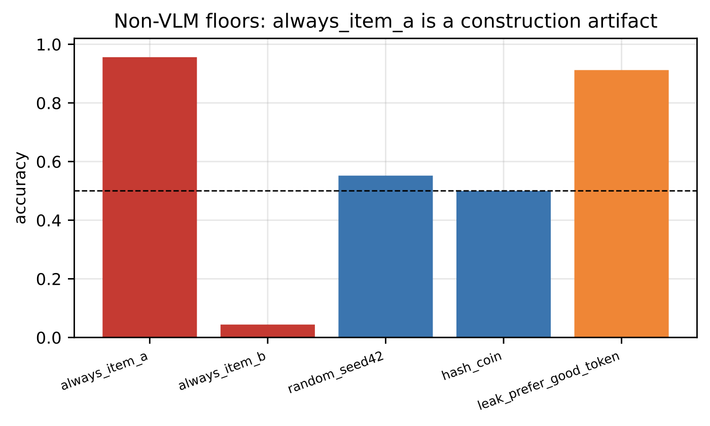
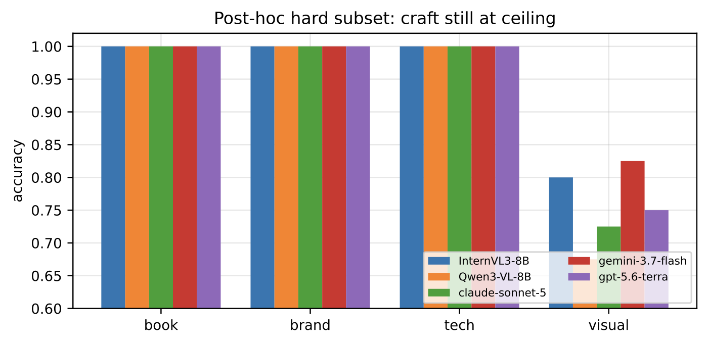

<div align="center">
  <h1>How to Build a Benchmark That Actually Measures Taste</h1>
  <p><sub><code>tastebench</code> · <a href="https://www.chance.vision">Chance AI</a> · arXiv:2610.14707 (v2, 2026-10-10) · 17 pages · 5 figures · 11 tables</sub></p>
  <p><em>Expert-aligned "taste" benchmarks should reward craft judgment, not the ability to game the test.</em></p>
  <p>
    <a href="https://arxiv.org/abs/2610.14707"></a>
    <a href="https://arxiv.org/abs/2610.14707"></a>
    <a href="main.pdf"></a>
    <a href="LICENSE"></a>
    <a href="code/LICENSE"></a>
    <a href="https://github.com/chancevision/tastebench/actions/workflows/build-pdf.yml"></a>
    <a href="CITATION.cff"></a>
    <a href="https://www.chance.vision"></a>
  </p>
  <p>
    <a href="https://arxiv.org/abs/2610.14707">Paper</a> ·
    <a href="main.pdf">PDF</a> ·
    <a href="#headline-numbers">Headline numbers</a> ·
    <a href="#code">Code</a> ·
    <a href="#citation">BibTeX</a> ·
    <a href="#license">License</a> ·
    <a href="https://github.com/chancevision/camera-first-agents">Companion paper</a>
  </p>
</div>

<table>
  <tr>
    <td width="50%" align="center"></td>
    <td width="50%" align="center"></td>
  </tr>
</table>

<sub><em>Left: the score is dominated by construction. Right: post-hoc difficulty does not move the craft ceiling.</em></sub>

| | |
|---|---|
| **Authors** | Xiaofan Wu (corresponding), Xi Zeng, Miaoxia Chen, Peishan Chen, Shuyan Li, Chen Wang, Xiaohan Wang, Wanling Xu, Jiyun Yao, Hanyong Zhong, Jiahao Zhu · [Chance AI](https://www.chance.vision) |
| **Status** | arXiv preprint — not peer-reviewed |
| **Categories** | `cs.AI` (primary) · cross-list `cs.CL`, `cs.CV` |
| **Gold** | Round-1 pilot: 250 expert pairs, three human experts, frozen rubric (panel *n* ≥ 3, percent agreement ≥ 0.60) |
| **Version** | v2 — the sources here match the arXiv e-print |

<a id="headline-numbers"></a>

## 🔍 Headline numbers

| Artifact | Measurement | Why it matters |
|---|---|---|
| **Position** | preferred item is slot A with probability **0.956**; an `always_item_a` policy scores **0.956** | fair chance is 0.5, so accuracy is reading the construction, not judgment |
| **Lexical leakage** | a filename-token cue scores **0.912** | filenames alone nearly match the leaderboard |
| **Difficulty ceiling** | craft domains hit **1.0** human agreement (book/brand/tech), and all five VLM cards hit **1.0** on craft | near-ceiling agreement makes "accuracy" uninformative in those domains |
| **Where it separates** | **visual** ≈ **0.84–0.91**; post-hoc hard subset (*n* = 107) still leaves craft at 1.0 | only one domain currently discriminates |
| **Fix works** | side randomization applied *at construction* removes the skew: **0.916 → 0.495 / 0.505** | position and leakage are fixable construction bugs, not model properties |

## 📄 What this paper does — and does not — claim

**Does:** quantifies three artifacts that undermine taste-benchmark validity; shows two of them
(position, lexical leak) are construction bugs with a mechanical fix; shows the third (craft-domain
ceiling) is a pair-difficulty limit that harder rounds must address; proposes expert-only gold with
a weak-label firewall, side randomization at construction, filename scrubbing, and hard filters.

**Does not:** evaluate engagement-as-taste, exercise era/circle conditioning, report calibration or
cue sensitivity, or claim any general taste SOTA. The "InternVL3-8B" leaderboard card is a
`gemma-3-12b-it` runtime substitute, not InternVL3 weights.

<a id="code"></a>

## 🛠️ Code

Released with the paper — MIT, in [`code/`](code/):

| | |
|---|---|
| [`code/tastebench_eval.py`](code/tastebench_eval.py) | reference eval harness: predictions CSV → metrics JSON, enforcing the frozen filter (gold only, `n_raters ≥ 3` and agreement `≥ 0.60`, ambiguous/excluded dropped) |
| [`code/randomize_pair_sides.py`](code/randomize_pair_sides.py) | side-randomization tool — the one that takes the position artifact from 0.916 to 0.495/0.505 |
| [`code/paper2_diagnostics.py`](code/paper2_diagnostics.py) | the two derived diagnostics: side-balance audit and cross-domain spread |
| [`code/build_cue_assignment.py`](code/build_cue_assignment.py) | cue-conditioned assignment and prompt banners |
| [`code/make_paper2_figures.py`](code/make_paper2_figures.py) | regenerates the five figures from the aggregate artifacts |
| [`code/prompts/`](code/prompts/) | the `prompt_v2` judge template and its cue-conditioned variant |

```bash
python code/tastebench_eval.py --preds preds.csv --gold bench_gold_primary_human.csv --out metrics.json
python code/randomize_pair_sides.py --pairs bench_pairs.csv --gold bench_gold_primary_human.csv --out pairs_balanced.csv
```

Details and expected inputs are in [`code/README.md`](code/README.md).

## 📰 News

- **2026-10-15** — manuscript sources and reference code published here; the PDF builds in CI on every push.
- **2026-10-10** — arXiv v2 posted.

## 📦 Contents

```
main.tex      manuscript source (matches the arXiv v2 e-print)
refs.bib      bibliography
main.pdf      compiled from this source
figures/      5 vector figures, generated by our analysis code
assets/       PNG previews of two figures for this page
code/         reference harness, tooling, prompts (MIT)
```

## 🚀 Build

```bash
latexmk -pdf -interaction=nonstopmode main.tex   # pdflatex + bibtex, as used by arXiv
# or:
tectonic -X compile main.tex
```

CI rebuilds the PDF on every push — see [`.github/workflows/build-pdf.yml`](.github/workflows/build-pdf.yml).

<a id="citation"></a>

## 📚 Citation

```bibtex
@misc{wu2026tastebench,
  title         = {How to Build a Benchmark That Actually Measures Taste},
  author        = {Wu, Xiaofan and Zeng, Xi and Chen, Miaoxia and Chen, Peishan and Li, Shuyan and Wang, Chen and Wang, Xiaohan and Xu, Wanling and Yao, Jiyun and Zhong, Hanyong and Zhu, Jiahao},
  year          = {2026},
  eprint        = {2610.14707},
  archivePrefix = {arXiv},
  primaryClass  = {cs.AI},
  url           = {https://arxiv.org/abs/2610.14707}
}
```

Machine-readable metadata: [`CITATION.cff`](CITATION.cff) (GitHub's **Cite this repository**).

<a id="license"></a>

## ⚖️ License

- **Manuscript, PDF, figures** — [CC BY 4.0](https://creativecommons.org/licenses/by/4.0/): share and adapt with attribution (cite the arXiv version).
- **Code and prompt templates** (`code/`) — [MIT](code/LICENSE).
- The arXiv record itself remains under [arXiv's non-exclusive license 1.0](https://arxiv.org/licenses/nonexclusive-distrib/1.0/).

**Excluded from both grants:** the benchmark item pool (third-party images and their annotations),
derived datasets, and the annotation pipelines. See [`LICENSING.md`](LICENSING.md); full CC BY text in
[`LICENSE`](LICENSE).
